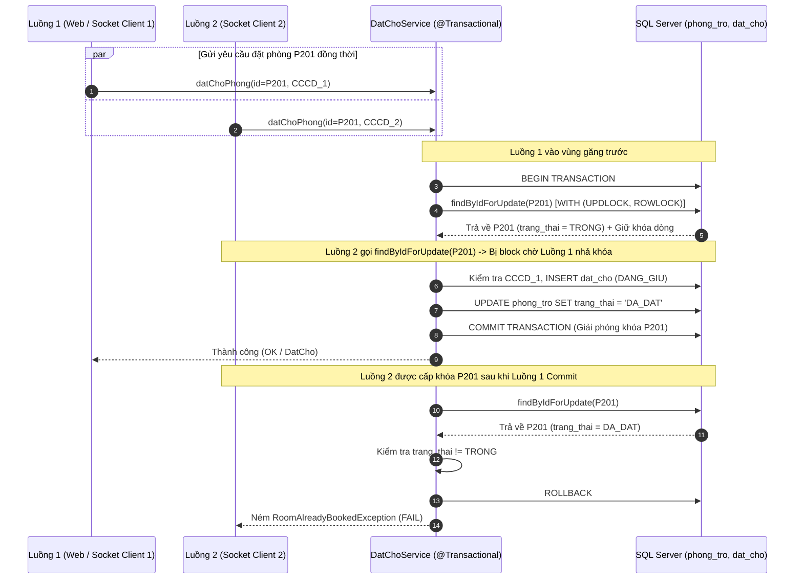
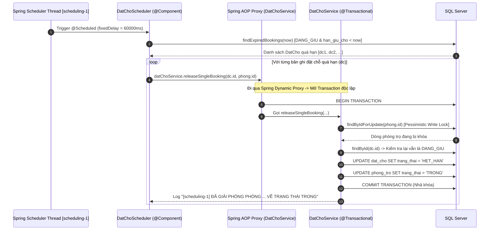

# Kiến Trúc Xử Lý Đồng Thời (Concurrency) & Tác Vụ Nền (`@Scheduled`)

Tài liệu kỹ thuật mô tả chi tiết cơ chế chống tranh chấp dữ liệu khi đặt phòng đồng thời và kiến trúc lập lịch nền giải phóng phòng/hợp đồng quá hạn trong hệ thống Quản Lý Nhà Trọ.

- **Phụ trách chính:** Bùi Trần Tấn Tài (TV2 – MSSV: 2001240413)
- **Các thành phần liên quan:** `PhongTroRepository`, `DatChoService`, `DatChoScheduler`, `HopDongService`

---

## 1. Cơ chế chống đặt/thuê trùng phòng (`PESSIMISTIC_WRITE`)

### 1.1. Bài toán thực tế (Race Condition)
Khi nhiều yêu cầu đặt giữ chỗ phòng (ví dụ phòng `P201`) được gửi đến cùng một thời điểm từ nhiều kênh khác nhau:
- Người dùng thao tác qua giao diện Web (`DatChoController`).
- Nhiều Desktop Client kết nối đồng thời qua Socket Server (`ClientHandler` gửi lệnh `BOOK P201#...`).

Nếu chỉ đọc trạng thái bằng `SELECT` thông thường rồi mới kiểm tra `TRONG` và cập nhật `DA_DAT`, cả hai luồng đều có thể đọc được trạng thái `TRONG` cùng lúc (hiện tượng **Lost Update / Double Booking**), dẫn đến 1 phòng bị đặt cho 2 khách hàng khác nhau.

### 1.2. Giải pháp kỹ thuật hai lớp
Hệ thống kết hợp **Monitor Lock tầng ứng dụng** và **Pessimistic Write Lock tầng CSDL** trong cùng một giao dịch `@Transactional`:

1. **Khóa mức Java (`synchronized (bookingLock)`):** Tuần tự hóa vùng găng trong JVM để ghi nhận log và thống kê `DatChoMonitor` chính xác theo thứ tự vào vùng găng.
2. **Khóa bi quan mức CSDL (`@Lock(LockModeType.PESSIMISTIC_WRITE)`):**
   Trong `PhongTroRepository`:
   ```java
   @Lock(LockModeType.PESSIMISTIC_WRITE)
   @Query("SELECT p FROM PhongTro p WHERE p.id = :id")
   Optional<PhongTro> findByIdForUpdate(@Param("id") Integer id);
   ```
   Khi chạy trên Microsoft SQL Server, JPA/Hibernate sinh câu truy vấn `SELECT ... WITH (UPDLOCK, ROWLOCK)` để khóa độc quyền dòng dữ liệu phòng trọ cho tới khi transaction kết thúc (`COMMIT` hoặc `ROLLBACK`).

### 1.3. Trình tự chuẩn trong Transaction (`DatChoService.datChoPhong`)
1. Mở giao dịch `@Transactional`.
2. **Khóa phòng trước:** Gọi `findByIdForUpdate(phongId)`. Luồng thứ hai đến sau buộc phải chờ luồng thứ nhất hoàn tất.
3. **Kiểm tra trạng thái phòng:** Nếu `trangThai != 'TRONG'`, lập tức ném `RoomAlreadyBookedException` (hoặc phản hồi `FAIL` về Socket Client) và rollback.
4. **Kiểm tra chống spam giữ chỗ:** Đếm số phiếu `DANG_GIU` hiện tại của `cccd` (`MAX_ACTIVE_BOOKINGS_PER_CCCD = 2`).
5. **Tìm hoặc tạo mới khách thuê** theo `cccd`.
6. **Lưu phiếu `dat_cho`** (`DANG_GIU`, `hanGiuCho = now + soGioGiuCho`) và chuyển `phong_tro.trang_thai = 'DA_DAT'`.
7. **Commit Transaction:** Giải phóng khóa `UPDLOCK, ROWLOCK`.

### 1.4. Sơ đồ tuần tự: Đặt phòng đồng thời qua Web & Socket



---

## 2. Kiến trúc Tác vụ nền (`@Scheduled`) & Lý do tách Bean (Spring AOP Proxy)

### 2.1. Vấn đề Spring AOP Self-Invocation
Trong Spring Framework, các annotation như `@Transactional` hoạt động dựa trên cơ chế **Dynamic Proxy (Spring AOP)** bao bọc bên ngoài Spring Bean:
- Khi một Bean bên ngoài gọi vào phương thức `@Transactional` của `DatChoService`, lời gọi đi qua **Spring Proxy**, giúp mở Transaction mới, gắn EntityManager và thực thi khóa `PESSIMISTIC_WRITE` chuẩn xác.
- **Lỗi Self-Invocation:** Nếu phương thức `@Scheduled` nằm cùng trong `DatChoService` và tự gọi `this.releaseSingleBooking(...)`, lời gọi đi thẳng bằng con trỏ `this` bên trong đối tượng thật, **bỏ qua Spring Proxy**. Hệ quả là `@Transactional` bị vô hiệu hóa, `findByIdForUpdate` không có Transaction bao bọc và gây lỗi hoặc mất khóa.

### 2.2. Giải pháp tách riêng `DatChoScheduler` và `DatChoService`
Để đảm bảo `@Transactional` và Pessimistic Lock luôn hoạt động đúng trong mọi luồng chạy nền:
- **`SchedulerConfig`:** Kích hoạt `@EnableScheduling`.
- **`DatChoScheduler` (`@Component`):** Chỉ chịu trách nhiệm lập lịch định kỳ (`@Scheduled(fixedDelay = 60000)` cho đặt chỗ quá hạn và `@Scheduled(cron = "0 5 0 * * *")` cho hợp đồng quá hạn), tiêm phụ thuộc `DatChoService` và `HopDongService` qua `@Autowired`.
- **`DatChoService.releaseSingleBooking(datChoId, phongId)`:** Chứa `@Transactional`, thực hiện khóa `findByIdForUpdate(phongId)`, kiểm tra lại trạng thái `DANG_GIU` rồi mới chuyển sang `HET_HAN` và trả phòng về `TRONG`.
- **Ghi log tên luồng:** Mọi bước xử lý đều in `Thread.currentThread().getName()` (ví dụ: `[scheduling-1]`) để kiểm chứng hoạt động đa luồng chạy nền.

### 2.3. Sơ đồ tuần tự: Tác vụ nền `@Scheduled` giải phóng đặt chỗ quá hạn


