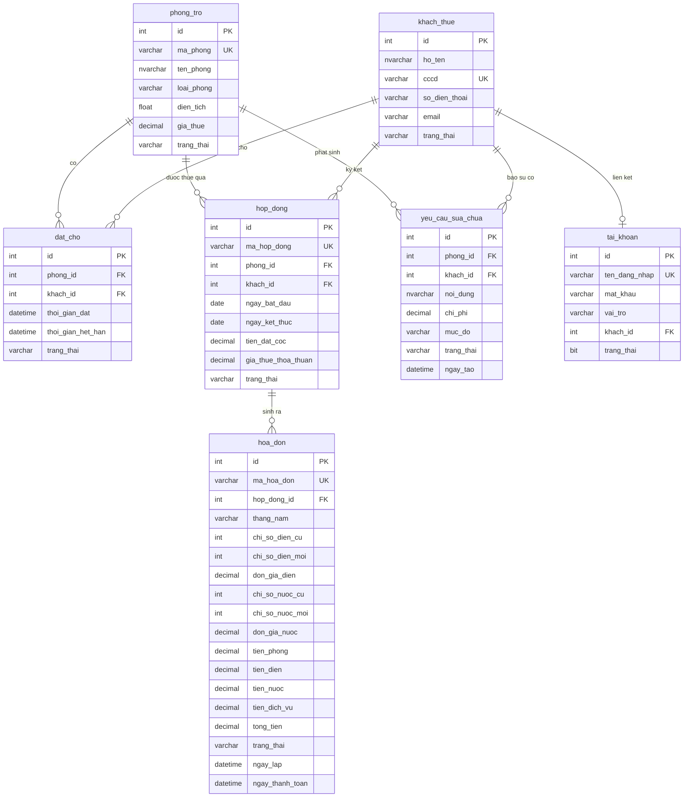

# Thiết Kế Cơ Sở Dữ Liệu & Nghiệp Vụ Hóa Đơn - Thu Ngân

## 1. Sơ đồ quan hệ thực thể (ERD - 7 bảng)

---

## 2. Công thức chốt số điện nước & tính tiền

Toàn bộ phép tính tài chính sử dụng kiểu `BigDecimal` để đảm bảo độ chính xác tuyệt đối, tránh sai số dấu phẩy động của `float`/`double`.

### Gợi ý chỉ số đầu kỳ tự động
- Khi chọn hợp đồng `hopDongId`, `HoaDonService.getChiSoDienNuoc` truy vấn hóa đơn gần nhất (`findTopByHopDongIdOrderByNgayLapDesc`).
- Lấy `chiSoDienMoi` và `chiSoNuocMoi` của kỳ trước làm `chiSoDienCu` và `chiSoNuocCu` của kỳ hiện tại (nếu chưa có hóa đơn nào thì mặc định `0`).

### Kiểm tra hợp lệ & Công thức
1. **Điều kiện bắt buộc:**
   - Hợp đồng phải đang ở trạng thái `HIEU_LUC`.
   - `chiSoDienCu >= 0`, `chiSoDienMoi >= chiSoDienCu`.
   - `chiSoNuocCu >= 0`, `chiSoNuocMoi >= chiSoNuocCu`.
2. **Lượng tiêu thụ:**
   - `soDien = chiSoDienMoi - chiSoDienCu` (kWh)
   - `soNuoc = chiSoNuocMoi - chiSoNuocCu` (m³)
3. **Đơn giá mặc định theo SQL:**
   - Đơn giá điện: `3.500` VNĐ/kWh (`DEFAULT 3500`)
   - Đơn giá nước: `20.000` VNĐ/m³ (`DEFAULT 20000`)
   - Phí dịch vụ chung: `100.000` VNĐ/tháng (`DEFAULT 100000`)
4. **Thành tiền:**
   - `tienDien = soDien * donGiaDien`
   - `tienNuoc = soNuoc * donGiaNuoc`
   - `tongTien = tienPhong + tienDien + tienNuoc + tienDichVu`

---

## 3. Ràng buộc duy nhất `UNIQUE(hop_dong_id, thang_nam)`

Hệ thống kiểm soát chống lập trùng 2 hóa đơn cho cùng một hợp đồng trong cùng một tháng ở cả 2 tầng:
1. **Tầng Database:** `CONSTRAINT UQ_hoa_don_hop_dong_thang UNIQUE (hop_dong_id, thang_nam)` trên bảng `hoa_don` và `@UniqueConstraint` trong entity `HoaDon`.
2. **Tầng Service:** Trước khi lưu, `HoaDonService` gọi `hoaDonRepository.existsByHopDongIdAndThangNam(hopDongId, thangNam)` và ném `BusinessException` với thông báo rõ ràng nếu phát hiện trùng kỳ thu.

---

## 4. Quy trình Thu ngân & Thống kê Dashboard

### Vòng đời trạng thái Hóa đơn
1. **Lập mới (`CHUA_THANH_TOAN`):**
   - Sinh mã hóa đơn chuẩn `HD-<MMyyyy>-<MaPhong>` (ví dụ `HD-112026-P101`).
   - Ghi nhận `ngayLap = LocalDateTime.now()`, `ngayThanhToan = null`.
2. **Xác nhận thanh toán / Gạch nợ (`POST /hoa-don/{id}/thanh-toan`):**
   - Kiểm tra nếu hóa đơn đã `DA_THANH_TOAN` thì từ chối gạch nợ trùng.
   - Chuyển `trangThai = "DA_THANH_TOAN"`, cập nhật `ngayThanhToan = LocalDateTime.now()`.
3. **Hoàn tác thanh toán (`POST /hoa-don/{id}/huy-thanh-toan`):**
   - Chuyển ngược trạng thái về `CHUA_THANH_TOAN`, đặt `ngayThanhToan = null`.
4. **Xóa hóa đơn nháp (`POST /hoa-don/{id}/xoa`):**
   - Chỉ cho phép xóa khi trạng thái là `CHUA_THANH_TOAN`.
   - Chặn xóa nếu hóa đơn đã `DA_THANH_TOAN` bằng `BusinessException` để bảo toàn dữ liệu kế toán.

### Số liệu Dashboard (`DashboardService`)
- Thực thi trong `@Transactional(readOnly = true)` và đẩy phép tính tổng xuống Database bằng JPQL `COALESCE(SUM(...), 0)`.
- **Doanh thu đã thu (`tongDoanhThuDaThu`):** Tổng `tongTien` các hóa đơn `DA_THANH_TOAN`.
- **Nợ chưa thu (`tongNoChuaThu`):** Tổng `tongTien` các hóa đơn `CHUA_THANH_TOAN`.
- **Chi phí sửa chữa (`tongChiPhiSuaChua`):** Tổng `chiPhi` từ bảng `yeu_cau_sua_chua`.
- **Lợi nhuận thực nhận (`loiNhuanThucNhan`):** `tongDoanhThuDaThu - tongChiPhiSuaChua`.
- **Tỷ lệ lấp đầy (`tiLeLapDay`):** `(soPhongDangThue / tongSoPhong) * 100`, làm tròn 1 chữ số thập phân (trả về `0.0` nếu `tongSoPhong == 0`).
