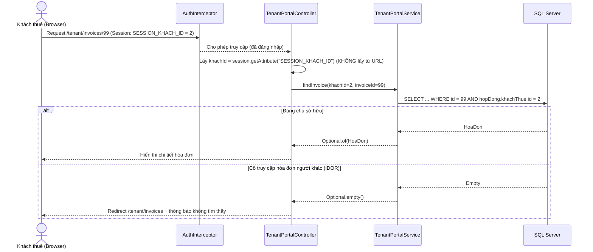

# Đặc tả Cổng Khách Thuê (Tenant Portal)

- **Phụ trách:** Lưu Quốc Trụ (TV3 — MSSV: 2001240521)
- **Nhánh phát triển:** `feature/tru-upgrade`
- **Phạm vi:** Backend, bảo mật cô lập dữ liệu và Unit Test cho toàn bộ phân hệ `/tenant/**`.

---

## 1. Luồng nghiệp vụ chính

### 1.1. Tra cứu & lọc nâng cao phòng trống (`GET /tenant/rooms`)
- Chỉ hiển thị phòng đang có trạng thái `TRONG`.
- Hỗ trợ kết hợp 5 tiêu chí lọc (đều tùy chọn / nullable):
  - `keyword`: tìm không phân biệt hoa thường theo `maPhong` hoặc `tenPhong`.
  - `loaiPhong`: lọc đúng loại phòng (`Đơn`, `Đôi`, `Studio`, `Gác lửng`, ...).
  - `giaTu` / `giaDen`: khoảng giá thuê (VNĐ/tháng).
  - `dienTichToiThieu`: diện tích tối thiểu (`m²`).
- Để tránh lỗi tham số `NULL` không rõ kiểu trên SQL Server, `TenantPortalService` thay cận mặc định (`0`, `999_999_999`, `0.0`) trước khi gọi `PhongTroRepository.searchAvailable(...)`.

### 1.2. Đặt giữ chỗ trực tuyến & hủy giữ chỗ
- **`POST /tenant/rooms/{id}/book`**:
  - Gọi `TenantPortalService.bookRoomForTenant(khachId, phongId, soGioGiuCho, ghiChu)`.
  - Kiểm tra khách thuê đang giữ tối đa **2 phòng `DANG_GIU`** cùng lúc (`TenantBookingRepository.countByKhachThueIdAndTrangThai`).
  - Ủy quyền sang `DatChoService.datChoPhong(...)` để dùng chung khóa bi quan `PESSIMISTIC_WRITE` (`findByIdForUpdate`), ngăn 2 khách cùng đặt 1 phòng.
- **`POST /tenant/bookings/{id}/cancel`**:
  - Gọi `TenantPortalService.cancelBookingByKhach(khachId, bookingId)`.
  - Kiểm tra đúng chủ sở hữu phiếu giữ chỗ (`booking.khachThue.id == khachId`) trước khi gọi `DatChoService.huyDatCho(...)`.

### 1.3. Tự đăng ký tài khoản khách thuê (`TenantRegisterDTO`)
- `TenantPortalService.registerTenantAccount(TenantRegisterDTO)` chạy trong 1 `@Transactional`:
  - Kiểm tra dữ liệu đầu vào: tên đăng nhập không trùng, mật khẩu ≥ 6 ký tự và trùng khớp xác nhận, CCCD 9–12 chữ số, SĐT `0xxxxxxxxx`, email hợp lệ.
  - Băm mật khẩu bằng `PasswordUtil.hash(rawPassword)` (SHA-256 kèm salt).
  - Liên kết với hồ sơ `KhachThue` hiện có theo CCCD (hoặc tạo mới nếu chưa tồn tại), gán vai trò `TENANT`.

### 1.4. Theo dõi hợp đồng, hóa đơn và phản ánh sự cố
- **Hợp đồng (`GET /tenant/contracts`)**: chỉ trả danh sách hợp đồng thuộc `khachId` hiện tại.
- **Hóa đơn (`GET /tenant/invoices`, `GET /tenant/invoices/{id}`)**: chỉ trả hóa đơn thuộc hợp đồng của `khachId`; mọi truy vấn theo `id` khác đều trả về `Optional.empty()` (chống IDOR).
- **Báo sự cố (`GET/POST /tenant/incidents/new`, `POST /tenant/incidents`)**: chỉ cho phép gửi phản ánh đối với phòng mà `khachId` đang có hợp đồng trạng thái `HIEU_LUC`.

---

## 2. Cơ chế cô lập dữ liệu (Data Isolation & chống IDOR)

- **`SESSION_KHACH_ID`** là nguồn tin cậy duy nhất: controller không bao giờ nhận `khachId` từ query param hay form body.
- Tài khoản `ADMIN`/`STAFF` xem trước giao diện khách thuê (`/tenant/rooms`, `/tenant/rooms/{id}`) vẫn được phép xem danh sách phòng trống nhờ `isLoggedIn(session)`, nhưng bị chặn tại các thao tác cá nhân cần hồ sơ `KhachThue` liên kết (`redirectMissingKhachProfile`).
